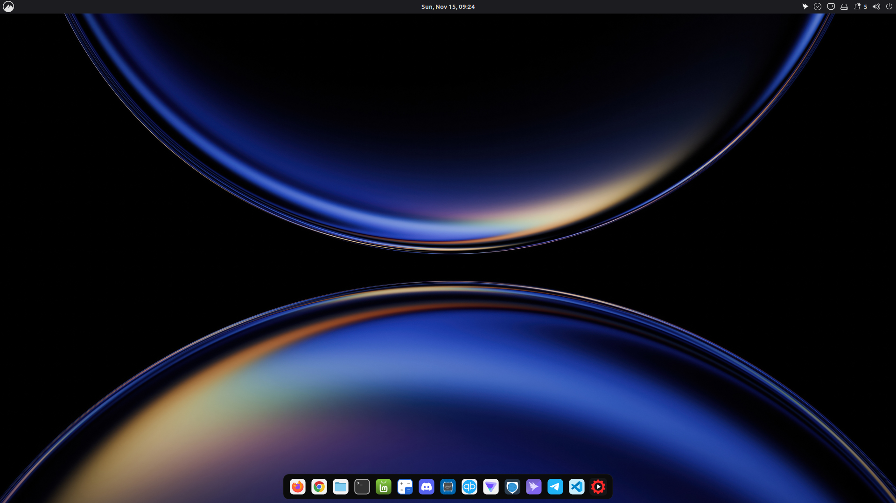
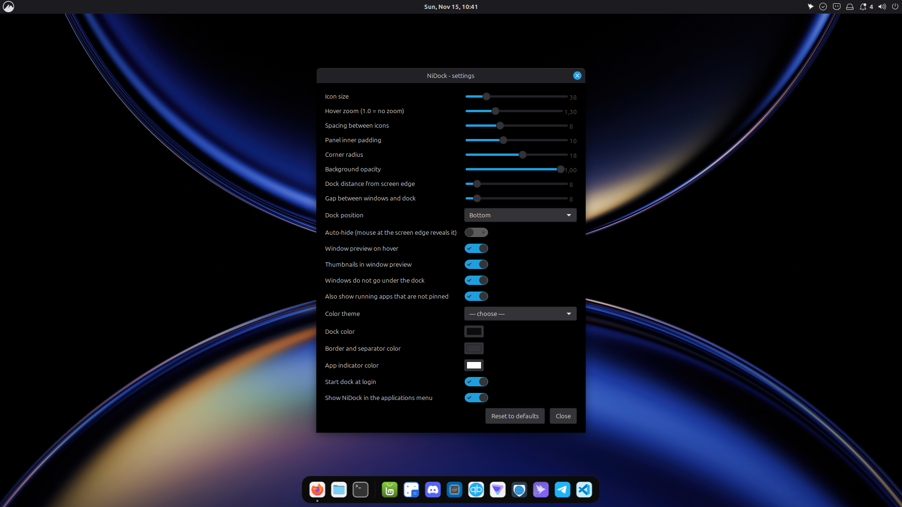
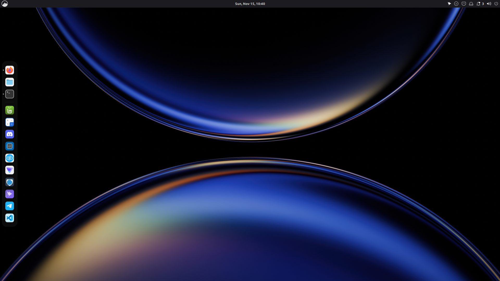
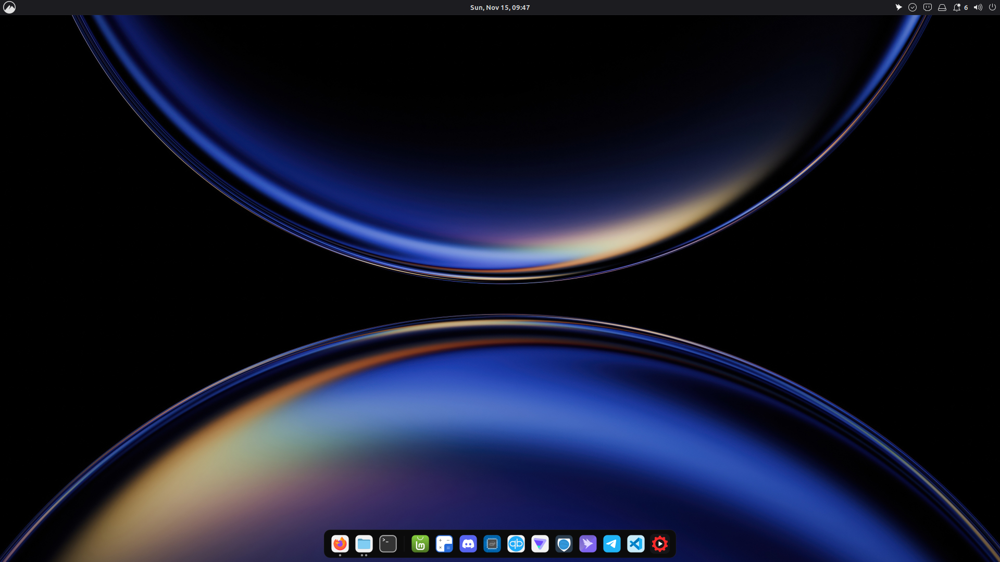
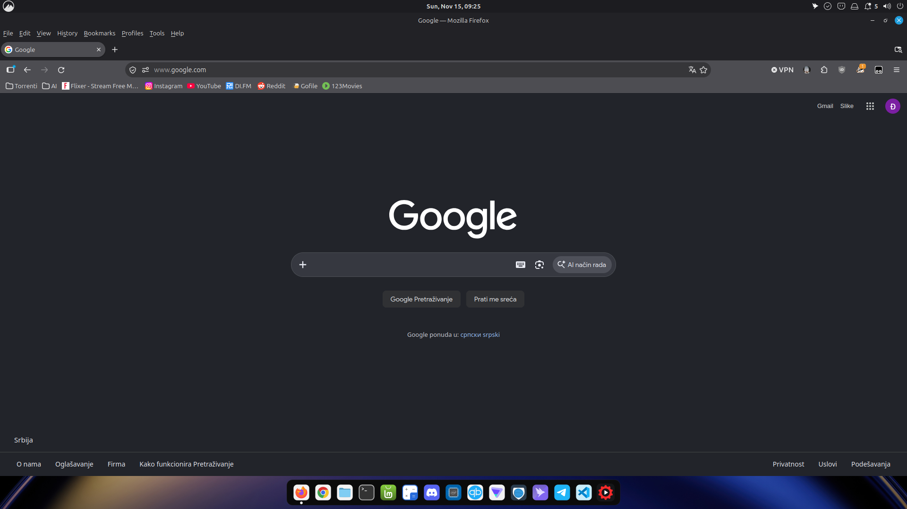
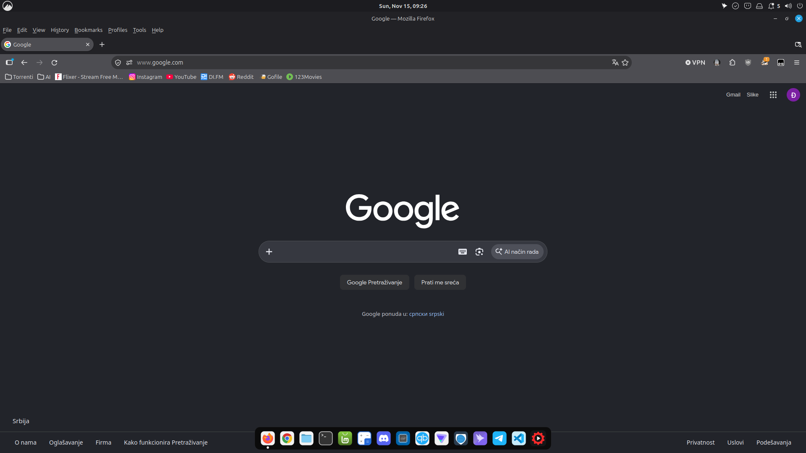

# NiDock

A simple, lightweight dock with a zoom effect for **Linux Mint (Cinnamon, X11)**, written in Python + GTK 3.

🇷🇸 Serbian version: [`nidock_sr.py`](nidock_sr.py) · [README.sr.md](README.sr.md)

## Screenshots



Right-click menu:



Dock on the left edge (position is set in the settings):



Custom separator:



Windows under the dock and above the dock (setting "Windows do not go under the dock"):




## Features

- Icon zoom on hover (macOS-style), smooth animation and launch bounce
- Pinned apps (drag to reorder) plus running apps that are not pinned
- Custom separators: right-click an icon → Add separator after; drag to move
- Running-window indicators; click to focus, minimize or cycle between windows
- Drag files onto an icon to open them with that app; drag a `.desktop` file from the applications menu onto the dock to pin it
- Window preview: hover an app with open windows to see thumbnails and titles, click one to jump to it (middle click closes it)
- Right-click menu: open, new window, app actions, close all windows, pin/unpin
- Colors: dock, border and indicator color pickers plus ready-made themes
- Dock position: bottom, left, right or top edge of the screen
- Auto-hide: the dock slides away and appears when the mouse reaches the screen edge
- Settings window: icon size, zoom, spacing, padding, corner radius, opacity, margins
- Built-in installer: start at login, applications-menu entry, auto-restart if it crashes

## Requirements

Requires an **X11** session. Works on Linux Mint (Cinnamon) and should work on other X11 desktops such as XFCE and MATE. It does **not** work on Wayland: Plasma 6.8+ and GNOME 50+ no longer offer an X11 session.

```bash
sudo apt install python3-gi python3-gi-cairo gir1.2-gtk-3.0 gir1.2-wnck-3.0 x11-utils
```

## Install

```bash
git clone https://github.com/zapovedniktutka/nidock.git
cd nidock
python3 nidock.py --install
```

This copies the dock to `~/.local/bin/nidock.py`, enables start at login, adds
**NiDock** to the applications menu and starts it right away. If it crashes, it is
restarted automatically; quitting it from its own menu keeps it closed.

> Only one language version can be installed at a time (both install to
> `~/.local/bin/nidock.py`). To switch, run `--install` from the other file.

## Usage

| Command | What it does |
|---|---|
| `python3 nidock.py` | Plain start, without supervision |
| `python3 nidock.py --install` | Install: autostart + menu entry + start now |
| `python3 nidock.py --uninstall` | Remove autostart, menu entry and installed copy |
| `python3 nidock.py --supervise` | Run the dock and restart it if it crashes |
| `python3 nidock.py --settings` | Open settings (starts the dock if needed) |

Right-click the dock → **Settings…** to change look and behaviour.
Settings are stored in `~/.config/nidock/config.json`.

## Updating

```bash
pkill -f nidock
git pull
python3 nidock.py --install
```

Your settings and pinned apps are kept.

## Uninstall

```bash
python3 nidock.py --uninstall
pkill -f nidock
```

Add `rm -rf ~/.config/nidock` to also remove the settings.

## Troubleshooting

- Run it from a terminal (`python3 ~/.local/bin/nidock.py`) to see error messages.
- `Wnck is not installed` warning: install `gir1.2-wnck-3.0`, otherwise running-app indicators do not work.
- Windows still go under the dock: install `x11-utils` (provides `xprop`) and keep
  *Windows do not go under the dock* enabled (it is ignored while auto-hide is on).

## License

MIT, see [LICENSE](LICENSE).
