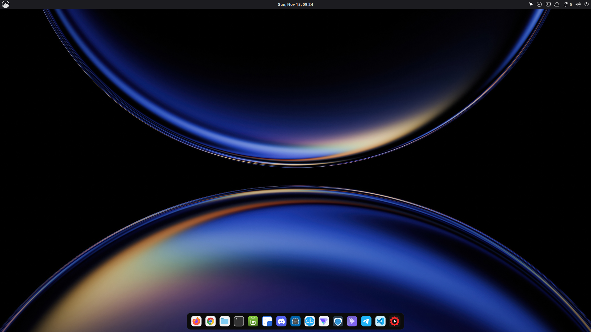
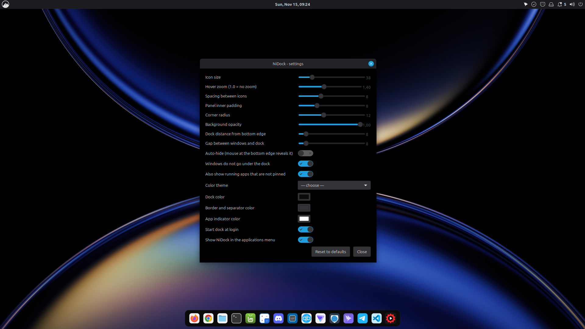
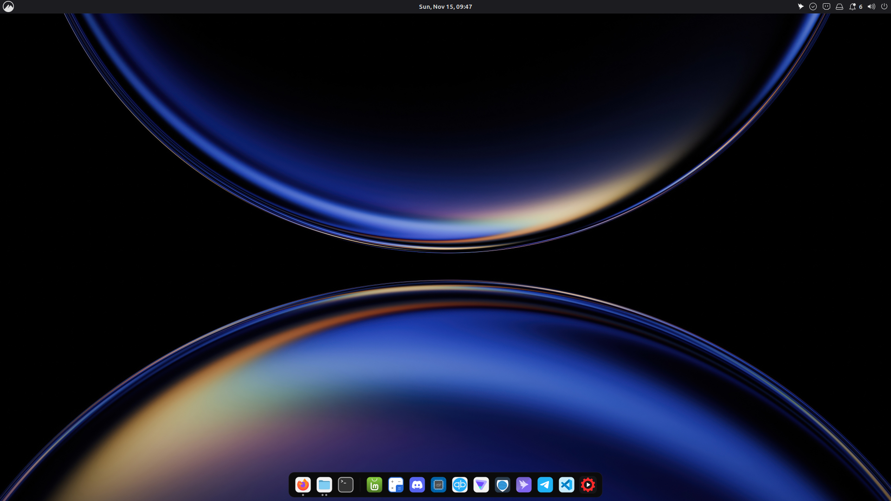
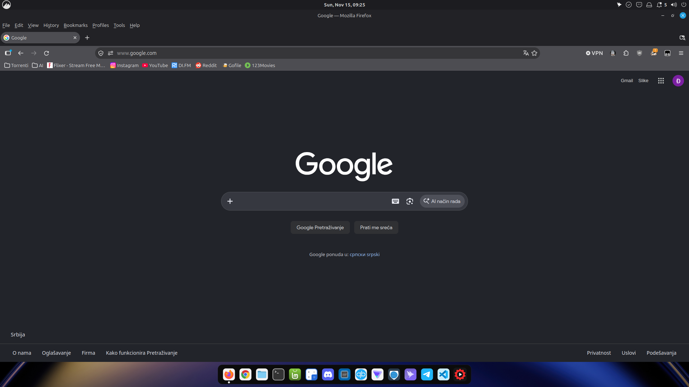
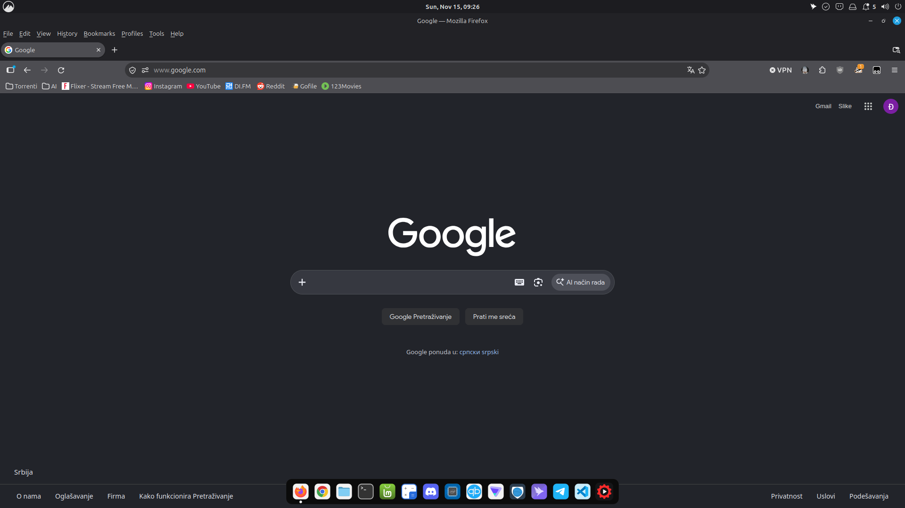

# NiDock

Jednostavan, lagan dok sa zum efektom za **Linux Mint (Cinnamon, X11)**, napisan u Pythonu + GTK 3.

🇬🇧 English version: [`nidock.py`](nidock.py) · [README.md](README.md)

## Slike ekrana



Meni na desni klik:



Sopstveni separator:



Prozori ispod doka i iznad doka (podešavanje "Prozori ne idu ispod doka"):




## Mogućnosti

- Zum ikonica pri prelasku mišem (kao na macOS-u), glatka animacija i skakanje pri pokretanju
- Zakačene aplikacije (prevlačenjem menjaš redosled) i pokrenute nezakačene aplikacije
- Sopstveni separatori: desni klik na ikonicu → Dodaj separator posle; prevlačenjem se pomeraju
- Indikatori pokrenutih prozora; klik fokusira, minimizuje ili prebacuje između prozora
- Meni na desni klik: otvori, novi prozor, akcije aplikacije, zatvori sve prozore, zakači/ukloni
- Boje: izbor boje doka, ivice i indikatora i gotove teme
- Automatsko sakrivanje: dok klizi ispod ekrana i izlazi kad miš dođe do donje ivice
- Prozor podešavanja: veličina ikonica, zum, razmaci, margina, zaobljenost, providnost
- Ugrađen instaler: pokretanje pri prijavi, unos u meni aplikacija, automatski restart ako pukne

## Zahtevi

Potrebna je **X11** sesija. Radi na Linux Mint-u (Cinnamon), a trebalo bi i na drugim X11 okruženjima kao što su XFCE i MATE. **Ne radi** na Waylandu: Plasma 6.8+ i GNOME 50+ više nemaju X11 sesiju.

```bash
sudo apt install python3-gi python3-gi-cairo gir1.2-gtk-3.0 gir1.2-wnck-3.0 x11-utils
```

## Instalacija

```bash
git clone https://github.com/zapovedniktutka/nidock.git
cd nidock
python3 nidock_sr.py --install
```

Ovo kopira dok u `~/.local/bin/nidock.py`, uključuje pokretanje pri prijavi, dodaje
**NiDock** u meni aplikacija i odmah ga pokreće. Ako pukne, automatski se vraća;
ako ga zatvoriš iz njegovog menija, ostaje zatvoren.

> Istovremeno može biti instalirana samo jedna jezička verzija (obe se instaliraju u
> `~/.local/bin/nidock.py`). Za promenu pokreni `--install` iz drugog fajla.

## Korišćenje

| Komanda | Šta radi |
|---|---|
| `python3 nidock_sr.py` | Običan start, bez nadzora |
| `python3 nidock_sr.py --install` | Instalacija: autostart + unos u meni + odmah pokreni |
| `python3 nidock_sr.py --uninstall` | Uklanja autostart, unos u meni i instaliranu kopiju |
| `python3 nidock_sr.py --supervise` | Radi dok i vraća ga ako pukne |
| `python3 nidock_sr.py --settings` | Otvara podešavanja (pokreće dok ako ne radi) |

Desni klik na dok → **Podešavanja…** za izgled i ponašanje.
Podešavanja se čuvaju u `~/.config/nidock/config.json`.

## Ažuriranje

```bash
pkill -f nidock
git pull
python3 nidock_sr.py --install
```

Podešavanja i zakačene aplikacije ostaju.

## Deinstalacija

```bash
python3 nidock_sr.py --uninstall
pkill -f nidock
```

Dodaj `rm -rf ~/.config/nidock` da obrišeš i podešavanja.

## Rešavanje problema

- Pokreni iz terminala (`python3 ~/.local/bin/nidock.py`) da vidiš poruke o greškama.
- Upozorenje `Wnck nije instaliran`: instaliraj `gir1.2-wnck-3.0`, inače indikatori pokrenutih aplikacija ne rade.
- Prozori i dalje idu ispod doka: instaliraj `x11-utils` (daje `xprop`) i drži uključeno
  *Prozori ne idu ispod doka* (ignoriše se dok je uključeno automatsko sakrivanje).

## Licenca

MIT, vidi [LICENSE](LICENSE).
